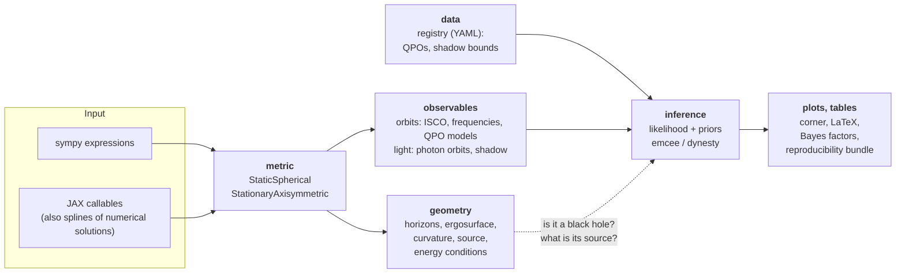

# How BlackPy works

This page is for a physicist who has never seen the code. It explains what
happens between "here is my metric" and "here is the posterior", and where to
add things. Formulas are in [Theory and formulas](theory.md).

## 1. The pipeline



| Stage | Package | What it does |
|---|---|---|
| metric | `blackpy.metric` | Holds the metric functions, their parameters (names, defaults, bounds, roles) and compiled-function caches |
| geometry | `blackpy.geometry` | Answers "what spacetime is this?": horizons, ergosurface, curvature scalars, effective stress-energy and its type, energy conditions |
| observables | `blackpy.orbits`, `blackpy.light` | Circular orbits, ISCO, epicyclic frequencies, QPO models; photon spheres and regions, shadows |
| data | `blackpy.data` | Loads measurements from YAML files that record where every number was read |
| inference | `blackpy.infer` | Builds the joint likelihood, runs emcee or dynesty, computes Bayes factors, and warns when a result should not be trusted |
| plots | `blackpy.plot` | Profile plots, corner plots, LaTeX tables |

## 2. "Symbolic in, numeric core"

You can define a metric in two ways.

- **Symbolically**, with sympy (`StaticSpherical.from_sympy`,
  `StationaryAxisymmetric.from_sympy`). BlackPy keeps the expressions for
  exact checks (is it a vacuum solution? is it reflection symmetric? what is
  the stress-energy tensor?) and converts them *once* into numerical
  functions with `sympy.lambdify(..., modules="jax")`.
- **Numerically**, with any function written with `jax.numpy`, for example a
  spline through a metric you obtained by solving field equations
  numerically. Symbolic checks are then skipped with a message, and their
  numerical versions are used.

After this point nothing in BlackPy looks at formulas any more. Every
observable is computed numerically from the metric functions by one small
toolbox (`blackpy/_numerics.py`). This is why a new metric needs no new
code: there are no metric-specific formulas to derive.

The catalogue metrics (Schwarzschild, Reissner–Nordström, Kerr, Johannsen,
...) are ordinary users of this interface: one file each, a few sympy lines.

## 3. Derivatives: automatic differentiation

The ISCO needs three radial derivatives of the metric functions; curvature
needs second derivatives in two variables. BlackPy never uses finite
differences. JAX differentiates the *program* that evaluates the metric
function (forward mode, `jax.jvp`, nested for higher orders), so derivatives
are exact to round-off, also for splines and for deformed metrics whose
derivatives nobody wants to write by hand.

Example: the radial epicyclic frequency of a rotating metric is
\(\Omega_r^2 = N_r / (2 g_{rr}\varrho^2)\), where \(N_r\) contains second
derivatives of \(g_{tt}\), \(g_{t\phi}\), \(g_{\phi\phi}\). The code evaluates
these three functions and their derivatives at the requested radius and
combines them; it agrees with the Kerr closed form to \(10^{-10}\).

## 4. Root finding

Horizons, photon orbits, the ISCO, the marginally bound orbit and the ends of
the shadow contour are all roots of some function of \(r\). They are found
by `find_roots`:

1. evaluate the function on a logarithmic grid of 256 radii between the
   horizon (or the lower end of `metric.r_range`) and the outer boundary;
2. refine every sign change with a safeguarded Newton iteration (Newton
   steps when they stay inside the bracket, bisection otherwise), with the
   derivative from autodiff;
3. also locate the *extrema* of the function and search on both sides of
   each one. This finds pairs of roots closer than the grid spacing (inner
   and outer horizon near extremality) and double roots (extremal horizons).

The result always has a fixed length, padded with NaN. That makes the whole
computation compilable (`jax.jit`) and vectorisable (`jax.vmap`): the ISCO of
10 000 Kerr spins is one call and takes about 0.01 ms per spin. "No root" is
a result (NaN, or `horizonless=True`), not an error: a naked singularity is a
legitimate configuration to study.

## 5. One pattern for every observable

Each observable is a pure **core function**

```python
def isco_core(metric, p, n_scan=256, ...):   # p: 1-D array of metric parameters
    ...
```

and a thin **public wrapper**

```python
def isco(metric, **params):
    return metric.evaluate(isco_core, params, ...)
```

`metric.evaluate` fills in default parameter values, checks bounds,
broadcasts arrays, and applies `jit(vmap(core))`, caching the compiled
function on the metric. So `bp.orbits.isco(kerr, a=0.5)` and
`bp.orbits.isco(kerr, a=np.linspace(0, 0.99, 1000))` are the same code.

Likelihoods call the core functions directly. The ISCO, the horizon and the
shadow are therefore solved *inside* the compiled likelihood, for every
proposed parameter vector.

**Static and rotating metrics.** The core functions look at the metric class
and forward rotating metrics to the general formulas
(`blackpy/orbits/axisymmetric.py`, `blackpy/light/rotating.py`,
`blackpy/geometry/axisymmetric.py`). Static metrics keep their shorter,
faster formulas. `static.as_axisymmetric()` sends a static metric through
the general path; the test-suite uses this to check each path against the
other.

## 6. How a fit runs, end to end

```python
fit = Fit(kerr, "qpo/gro_j1655_40", qpo_model="RP",
          priors={"a": Uniform(0, 0.998), "r": Uniform(2, 20)}, sampler="emcee")
result = fit.run(seed=1)
```

1. **Data.** The registry file is loaded and validated. Every number carries
   its source and location; unverified data trigger a warning.
2. **Parameters.** Metric parameters that have a prior are sampled; the
   others are fixed. Each QPO source adds its own mass `M_<source>` (solar
   masses) and orbital radius `r_<source>` (units of \(M\)). The mass prior
   defaults to the *independent* (dynamical) mass in the registry. Shadow
   data with a rotating metric add the inclination as a nuisance parameter.
3. **Likelihood.** For a proposed parameter vector: frequencies of the
   chosen QPO model at that radius and mass, compared with the measured
   peaks (split normal for asymmetric errors); for a triplet and a rotating
   metric also the nodal precession frequency; for shadow data the shadow
   radius. Zero likelihood outside the metric's black hole domain. The
   function is compiled once.
4. **Sampling.** emcee (walkers start in a small ball around the posterior
   maximum; runs until the chain is longer than 50 autocorrelation times) or
   dynesty (nested sampling, which also gives the evidence).
5. **Guards.** Before returning, BlackPy checks and warns about: a mass
   prior that itself came from a QPO fit (circular inference); a posterior
   indistinguishable from its prior (not a constraint); an unconverged
   chain; a static metric fitted to a rotating source; spin strongly
   degenerate with another metric parameter.
6. **Result.** Samples, summary, diagnostics, and a record of everything
   needed to repeat the run (versions, seed, priors, dataset hashes), saved
   as one `.npz` file. `fit.bayes_factor(null={...})` compares with a nested
   model.

## 7. How to add a new metric

Nothing inside BlackPy has to change.

```python
import sympy as sp
import blackpy as bp

r, k = sp.symbols("r k", real=True)
metric = bp.StaticSpherical.from_sympy(1 - 2/r + k/r**3, parameters={"k": 0.0}, name="my metric")
print(bp.geometry.report(metric, k=0.3))       # horizons, source, energy conditions
rotating = bp.metric.rotating_from_static(metric)   # a model: check its source too
```

For a rotating metric given directly, pass the five components
\(g_{tt}, g_{t\phi}, g_{\phi\phi}, g_{rr}, g_{\theta\theta}\) as functions of
`(r, theta)` to `StationaryAxisymmetric.from_sympy` (or as JAX callables).
BlackPy then checks reflection symmetry (needed for equatorial orbits) and
separability of null geodesics (needed for the analytic shadow), and refuses
clearly when a requested observable needs a property the metric lacks.

To add a metric to the built-in catalogue: one file in
`src/blackpy/metric/catalogue/` with the literature reference in its
docstring, an entry in `catalogue/__init__.py`, and at least one test of a
known limit. The full walk-through is the [tutorial](tutorial.md).

## 8. How to add a dataset

A dataset is one YAML file under `src/blackpy/data/registry/` (or anywhere,
loaded with `blackpy.data.load_file`). The rules are strict on purpose:

- a number may be entered only if it was read from the original paper, with
  the table, figure or section recorded in `location`;
- a value that could not be checked is `null` with a `todo` entry;
- `verified_by_human` stays `false` until a person has compared the file
  with the paper;
- a mass that was itself derived from a QPO fit is marked
  `independent: false`, and using it as a prior triggers a warning.

See [Data registry](data.md) for the schema.

## 9. What BlackPy does not do

Ray tracing for non-separable metrics (use Gradus.jl), plasma, weak and
strong lensing, quasinormal modes, thermodynamics and S2-orbit data are
outside version 0.2. Their interfaces exist and raise `NotImplementedError`
with a pointer to the roadmap in `DESIGN_NOTES.md`.
