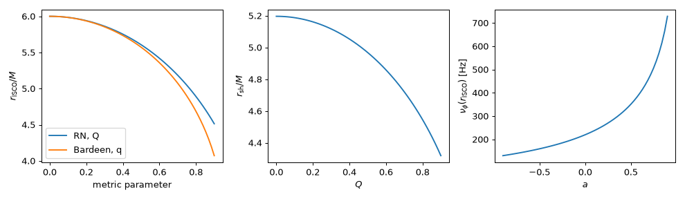
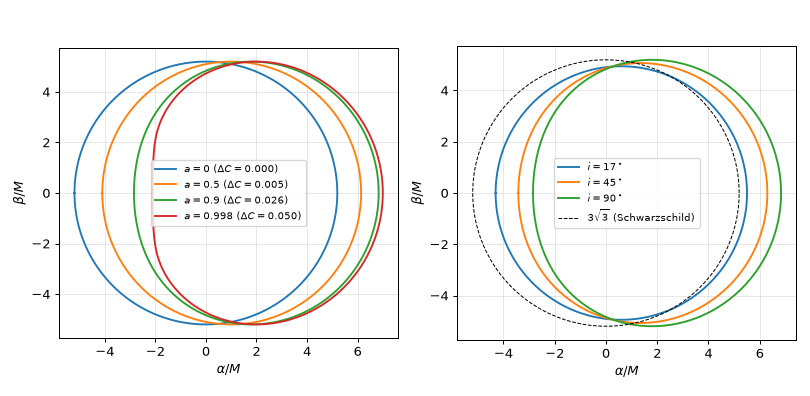
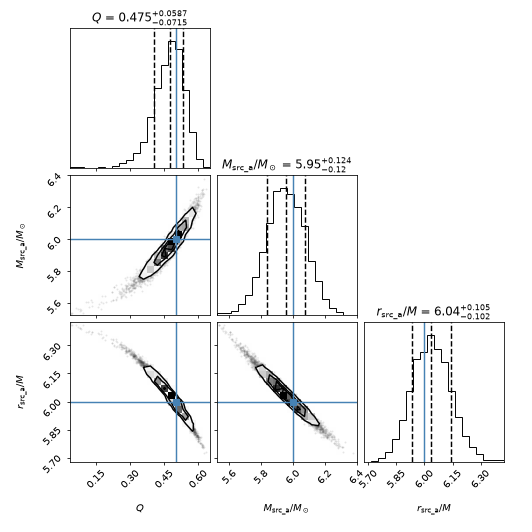
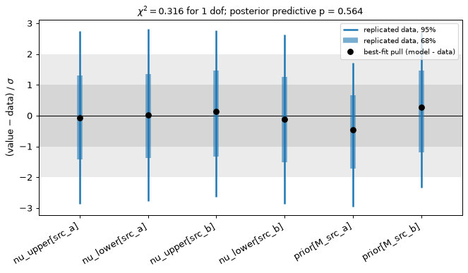
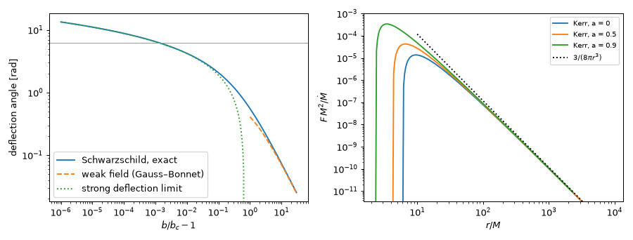
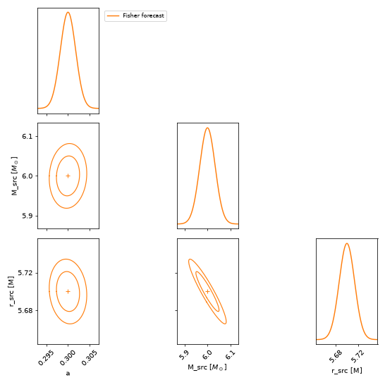
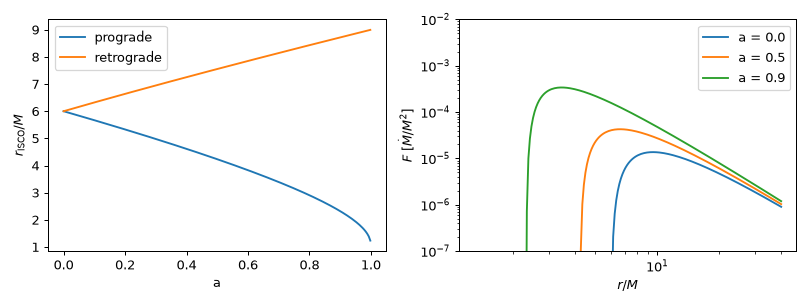

# User guide

This page explains how to install BlackPy and how to use **every calculation
and every plot** it offers, with code you can copy. Every snippet on this
page is executed by the test-suite (`tests/test_docs.py`), and every output
shown under "Output" is what the snippet printed when the page was last
generated; the test checks that it still prints exactly that. Numbers are
rounded so that they do not depend on the machine. Outputs marked "Output
(registry data)" contain values of the [data registry](data.md), which have
not yet been verified by a human; the test runs those snippets but does not
compare their numbers.

The snippets build on each other: run them in order in one Python session
(or notebook). Warnings that a snippet emits on purpose are listed in a
`# warns:` comment in the snippet and explained in
[Integrity guards and errors](#11-integrity-guards-and-errors).

Other pages: [How BlackPy works](how_it_works.md) (architecture),
[Tutorial](tutorial.md) (one complete analysis), [Theory](theory.md) (every
formula with its source), [Data registry](data.md), [API reference](api.md),
[Roadmap](roadmap.md).

## 1. Getting started

### Installation

BlackPy needs Python 3.10 or newer. Work in a virtual environment.

From PyPI, once the package is released (the distribution is called
`blackpy-gr`; the import name is `blackpy`):

```text
python3 -m venv .venv
.venv/bin/python -m pip install blackpy-gr
```

From the repository (editable install, with the test and documentation tools):

```text
git clone https://github.com/YovkochevPakhlavon/BlackPy
cd BlackPy
python3 -m venv .venv
.venv/bin/python -m pip install -e ".[dev,docs]"
```

On **Windows** (PowerShell) use `.venv\Scripts\python.exe` instead of
`.venv/bin/python`. The script `scripts\check_windows.ps1` installs BlackPy
and runs every check in one command:

```text
powershell -ExecutionPolicy Bypass -File scripts\check_windows.ps1
powershell -ExecutionPolicy Bypass -File scripts\check_windows.ps1 -SkipInstall -Full -Examples
powershell -ExecutionPolicy Bypass -File scripts\check_windows.ps1 -SkipInstall -ExamplesQuick
```

It writes `build\windows-check\SUMMARY.txt`. `-ExamplesQuick` runs the
examples with `BLACKPY_EXAMPLES_QUICK=1` (smaller sampler settings, about a
minute per example).

**Check the installation** with one line:

```text
python -c "import blackpy as bp; print(bp.__version__, float(bp.orbits.isco(bp.metric.Kerr(), a=0.6)))"
```

It prints the version and the Kerr ISCO for spin 0.6, `3.829069...`.

### The first five lines

```python
import math

import numpy as np

import blackpy as bp

kerr = bp.metric.Kerr()
print(f"ISCO of Kerr, a = 0.6: {float(bp.orbits.isco(kerr, a=0.6)):.6f} M")
```

```text title="Output"
ISCO of Kerr, a = 0.6: 3.829069 M
```

### Units

| Quantity | Unit | Example |
|---|---|---|
| lengths, radii, impact parameters | units of the black hole mass \(M\) (\(G = c = 1\)) | `isco(...)` returns 6 for Schwarzschild |
| metric parameters | units of \(M\) to the power their dimension needs (a charge \(Q\) in \(M\), \(\Lambda\) in \(M^{-2}\)) | `Q=0.5` |
| frequencies in geometric units | \(1/M\) | `angular_velocity(...)` |
| frequencies in hertz | Hz; need the mass in **solar masses** (`mass=`, `mass_msun=`) | `frequencies_hz(kerr, r=6, mass=5.4, a=0.3)` |
| **angles** | **radians**; a quantity in degrees has **`_deg` in its name** | `shadow_contour(kerr, math.radians(60), a=0.9)`; the fit parameter `inclination_deg` |
| observed angles (lensing, Einstein ring) | microarcseconds (µas), stated in the docstring | `einstein_ring_angle(...)` |
| distances to sources | kpc (`distance_kpc`, `distance_lens_kpc`); the registry also stores Mpc for M87\* | |
| masses | solar masses | `mass=10.0` |

The rule for angles is checked: a function that takes an inclination in
radians refuses a value outside \([0, \pi]\) and suggests `math.radians`.
The table of every argument of every public function is in
[section 12](#12-unit-table-of-the-public-functions).

### Results are JAX arrays

Every observable returns a JAX array; for scalar input it is a 0-d array.
Use `float(...)` when you need a Python number. Metric parameters can be
arrays: the function is vectorised over them (broadcasting like NumPy).

```python
a = np.linspace(0.0, 0.9, 4)
r_isco = bp.orbits.isco(kerr, a=a)  # one call, four spins
import jax

print(isinstance(r_isco, jax.Array), r_isco.shape)
print(np.round(np.asarray(r_isco), 4))
```

```text title="Output"
True (4,)
[6.     4.9786 3.8291 2.3209]
```

**The first call compiles.** Each observable is compiled with `jax.jit` the
first time it is called for a given metric and array shape; that takes from
a fraction of a second to tens of seconds (rotating shadows). Later calls with
the same shapes take micro- to milliseconds. See the
[FAQ](#slow-first-call) for the persistent compilation cache.

**NaN means "not found".** A vectorised function returns NaN where the
quantity does not exist (no horizon, no ISCO, no shadow), instead of raising,
so that a parameter scan never stops in the middle. Functions that list
everything for one configuration (`horizons`, `photon_spheres`,
`marginally_stable_orbits`) return explicit result objects instead. A
horizonless configuration is a result, not an error.

**Warnings.** BlackPy uses warnings (subclasses of
`blackpy.errors.BlackPyWarning`) to say when a result must not be
over-interpreted: unverified data, a circular mass prior, a prior-dominated
posterior, an unconverged chain, a poor fit. Read them; never silence them
globally. [Section 11](#11-integrity-guards-and-errors) lists all of them.

**Where files go.** The functions of `blackpy.plot` return matplotlib axes
and never save anything; you call `fig.savefig(...)`. The example scripts in
`examples/` write their figures to `examples/output/`.

## 2. Defining a metric

### The catalogue

| Name | Parameters (default, range) | Class | Reference |
|---|---|---|---|
| `Schwarzschild()` | none | static | Schwarzschild (1916) |
| `ReissnerNordstrom()` | `Q` (0, \(Q \ge 0\); horizon for \(Q \le 1\)) | static | Reissner (1916); Nordström (1918) |
| `SchwarzschildDeSitter()` | `Lambda` (0, \(\Lambda \ge 0\)) | static, not asymptotically flat for \(\Lambda > 0\) | Kottler (1918) |
| `Bardeen()` | `q` (0, \(q \ge 0\)) | static, regular | Bardeen (1968); Ayón-Beato & García (2000) |
| `Hayward()` | `l` (0, \(l \ge 0\)) | static, regular | Hayward (2006) |
| `GMGHS()` | `Q` (0, \(0 \le Q \le \sqrt 2\)) | static | Gibbons & Maeda (1988); Garfinkle, Horowitz & Strominger (1991) |
| `SimpsonVisser()` | `ell` (0, \(\ell \ge 0\)) | static, black bounce | Simpson & Visser (2019) |
| `Kerr()` | `a` (0; black hole for \(\lvert a\rvert \le 1\)) | rotating | Kerr (1963) |
| `KerrNewman()` | `a`, `Q` (\(a^2 + Q^2 \le 1\)) | rotating | Newman et al. (1965) |
| `KerrSen()` | `a`, `Q` (\(0 \le Q \le \sqrt 2\)) | rotating | Sen (1992) |
| `Johannsen()` | `a`, `alpha13`, `alpha22`, `alpha52`, `epsilon3` | rotating, deformed Kerr | Johannsen (2013) |
| `RotatingBardeen()` | `a`, `q` | rotating (generated model) | Bambi & Modesto (2013) |
| `RotatingHayward()` | `a`, `l` | rotating (generated model) | Bambi & Modesto (2013) |
| `RezzollaZhidenko(order, ppn)` | `epsilon`, `a1..an`, `b1..bn` (and `a0`, `b0` with `ppn="free"`) | static, parametrised | Rezzolla & Zhidenko (2014) |
| `KRZ()` | `a` and the lowest-order deviations | rotating, parametrised | Konoplya, Rezzolla & Zhidenko (2016) |

The static entries are in `bp.metric.CATALOGUE`, the rotating ones in
`bp.metric.ROTATING_CATALOGUE`. Parameter bounds describe where the metric
functions are defined, not where a black hole exists: a Reissner–Nordström
metric with `Q = 1.2` is a valid input and is reported as horizonless.
Theory: sections [1](theory.md#1-conventions),
[12](theory.md#12-rotating-metrics-conventions-and-catalogue),
[21](theory.md#21-parametrised-metrics-rezzollazhidenko-and-krz) and
[25](theory.md#25-further-catalogue-metrics).

```python
rn = bp.metric.ReissnerNordstrom()
print(rn)
print([p.name for p in kerr.parameters], kerr.spin_parameter)
print(sorted(bp.metric.CATALOGUE), sorted(bp.metric.ROTATING_CATALOGUE))
```

```text title="Output"
StaticSpherical(name='Reissner-Nordstrom', parameters=[Q=0.0], symbolic)
['a'] a
['Bardeen', 'GMGHS', 'Hayward', 'ReissnerNordstrom', 'Schwarzschild', 'SchwarzschildDeSitter', 'SimpsonVisser'] ['Johannsen', 'Kerr', 'KerrNewman', 'KerrSen', 'RotatingBardeen', 'RotatingHayward']
```

### From sympy expressions

`StaticSpherical.from_sympy(f, g=None, h=None, parameters=...)` takes the
metric functions of \(ds^2 = -f\,dt^2 + dr^2/g + h\,d\Omega^2\) (`g` defaults
to `f`, `h` to \(r^2\)). sympy runs the geometry checks once, then the
expressions are converted to JAX. Rotating metrics:
`StationaryAxisymmetric.from_sympy(g_tt=..., g_tphi=..., g_phiphi=..., g_rr=..., g_thth=...)`.

```python
import sympy as sp

r, beta = sp.symbols("r beta", real=True)
custom = bp.StaticSpherical.from_sympy(
    1 - 2 / r + beta / r**2, parameters={"beta": 0.0}, name="custom"
)
print(custom.symbolic.f)
print(bp.geometry.stress_energy_symbolic(custom))
```

```text title="Output"
beta/r**2 + 1 - 2/r
{'rho': beta/(8*pi*r**4), 'p_r': -beta/(8*pi*r**4), 'p_t': beta/(8*pi*r**4)}
```

### From a callable or a table

Any JAX-traceable function works; parameter names and defaults are read from
its signature. Symbolic checks are then skipped (asking for one raises
`SymbolicUnavailableError`). A numerical solution given on a grid becomes a
smooth, differentiable function with `bp.metric.interpolated.spline`.

```python
numeric = bp.StaticSpherical(lambda r, alpha=0.0: 1 - 2 / r + alpha / r**2, name="numeric")
print(
    round(float(bp.orbits.isco(numeric, alpha=0.25)), 6), round(float(bp.orbits.isco(rn, Q=0.5)), 6)
)

grid = np.geomspace(1.5, 400.0, 4000)
f_table = bp.metric.interpolated.spline(grid, 1 - 2 / grid)  # stands for your numerical solution
tabulated = bp.StaticSpherical(lambda r: f_table(r), r_range=(1.5, 400.0), asymptotically_flat=True)
print(round(float(bp.orbits.isco(tabulated)), 6))
```

```text title="Output"
5.606643 5.606643
6.0
```

### Rotating metrics from static ones

`rotating_from_static(static_metric)` applies the Azreg-Aïnou (2014) version
of the Newman–Janis algorithm and adds a spin parameter `a`. The result is
**a model**: the algorithm does not solve any field equations, so the source
of the new metric is whatever it is. Check it with
`bp.geometry.effective_source` before you call the metric a solution of a
theory (theory section [13](theory.md#13-geometry-of-rotating-metrics)).

```python
rotating_hayward = bp.metric.rotating_from_static(bp.metric.Hayward())
print(rotating_hayward.param_names)
print(bp.geometry.effective_source(rotating_hayward, a=0.5, l=0.5).summary())
```

```text title="Output"
('a', 'l')
Effective source: anisotropic fluid (grid points by type: anisotropic fluid: 168)
  grid: r in [1.72918, 51.8754], theta in [0.15, 2.992]
NEC: satisfied on the grid
WEC: satisfied on the grid
SEC: satisfied on the grid
DEC: VIOLATED at 168 of 168 grid points (r from 1.72918 to 51.8754)
```

### Parametrised metrics: Rezzolla–Zhidenko and KRZ

`RezzollaZhidenko(order=2)` is the continued-fraction parametrisation of
static metrics; `rz_coefficients(metric, order, **params)` maps any static,
asymptotically flat metric with a horizon onto it. `KRZ()` is the rotating
parametrisation (lowest order) with Kerr at zero deviation; it is a model
(source unchecked) and its null geodesics do not separate, so its shadow is
refused. Theory section [21](theory.md#21-parametrised-metrics-rezzollazhidenko-and-krz);
example `12_parametrised_metrics.py`.

```python
coefficients = bp.metric.rz_coefficients(bp.metric.Bardeen(), order=3, q=0.5)
print(f"epsilon = {coefficients.epsilon:.6f}, r0 = {coefficients.r0:.6f}")
rz = bp.metric.RezzollaZhidenko(order=2)
print(rz.param_names)
krz = bp.metric.KRZ()
print(round(float(bp.orbits.isco(krz, a=0.5)), 6), round(float(bp.orbits.isco(kerr, a=0.5)), 6))
```

```text title="Output"
epsilon = 0.119841, r0 = 1.785968
('epsilon', 'a1', 'a2', 'b1', 'b2')
4.233003 4.233003
```

### A metric with a plasma

`with_plasma(metric, plasma)` returns the metric with a cold, pressureless,
non-magnetised plasma attached; the plasma parameters (for example
`omega_p`, the plasma frequency in units of the photon frequency at infinity)
become parameters of the result. Only light is affected. See
[Plasma](#plasma).

```python
plasma = bp.light.PowerLawPlasma(k=1.5)
with_plasma = bp.light.with_plasma(bp.metric.Schwarzschild(), plasma)
print(with_plasma.param_names)
```

```text title="Output"
('omega_p', 'k')
```

## 3. Geometry (`blackpy.geometry`)

Theory: sections [2](theory.md#2-horizons) to [4](theory.md#4-energy-conditions)
and [13](theory.md#13-geometry-of-rotating-metrics). Example: `01_new_metric.py`.

### Horizons

`horizons(metric, **params)` lists every horizon of one configuration and
classifies it; `event_horizon(metric, **params)` is the vectorised radius of
the **event horizon = the outermost black hole horizon, not the cosmological
horizon** (NaN if there is none); `cosmological_horizon(...)` is the
outermost horizon of a de Sitter-like metric. Radii in units of \(M\).

- `horizons(metric, *, n_scan=256, max_roots=6, degenerate_atol=1e-10, **params) -> HorizonResult`
  with `horizons` (list of `Horizon(radius, kind, degenerate, f_vanishes)`),
  `event_horizon` and `cosmological_horizon` (radii, or None), `horizonless`, `radii`,
  `theta_independent`, `message`. Scalar parameters only.
- `event_horizon(metric, theta=None, *, n_scan=256, **params)`: array; for a
  rotating metric `theta` (radians) selects the polar angle.

```python
result = bp.geometry.horizons(rn, Q=0.6)
print([(round(h.radius, 6), h.kind) for h in result.horizons], round(result.event_horizon, 6))
print(np.round(np.asarray(bp.geometry.event_horizon(rn, Q=np.array([0.0, 0.8, 1.2]))), 6))
naked = bp.geometry.horizons(rn, Q=1.2)
print(naked.horizonless, naked.event_horizon)
sds = bp.metric.SchwarzschildDeSitter()
print(
    round(float(bp.geometry.event_horizon(sds, Lambda=0.01)), 6),
    round(float(bp.geometry.cosmological_horizon(sds, Lambda=0.01)), 6),
)
```

```text title="Output"
[(0.2, 'inner'), (1.8, 'event')] 1.8
[2.  1.6 nan]
True None
2.027794 16.217355
```

For rotating metrics the horizon is a root of \(g^{rr}\); it is the event
horizon only if it does not depend on \(\theta\), and `theta_independent`
reports whether it does. `horizon_profile(metric, theta=None, **params)`
gives the radius at several polar angles (`HorizonProfile(theta, radius,
theta_independent, message)`), and `ergosurface(metric, theta=pi/2,
**params)` the outer boundary of the ergoregion (\(g_{tt} = 0\)).

```python
print([round(x, 6) for x in bp.geometry.horizons(kerr, a=0.9).radii])
print(round(float(bp.geometry.ergosurface(kerr, theta=math.pi / 2, a=0.9)), 6))
print(bp.geometry.horizon_profile(kerr, a=0.9).theta_independent)
```

```text title="Output"
[0.56411, 1.43589]
2.0
True
```

### Curvature and the effective source

`kretschmann(metric, r, theta=None, **params)`,
`ricci_scalar(metric, r, theta=None, **params)` and
`einstein_tensor(metric, r, theta=None, **params)` evaluate curvature by
automatic differentiation (units: \(M^{-4}\), \(M^{-2}\), \(M^{-2}\)).
`stress_energy(metric, r, **params)` returns `StressEnergy(rho, p_r, p_t)`
with \(G^\mu{}_\nu = 8\pi T^\mu{}_\nu\), \(\rho = -T^t{}_t\),
\(p_r = T^r{}_r\), \(p_t = T^\theta{}_\theta\) (static metrics). The
`*_symbolic` versions return sympy expressions for symbolic metrics (a time
limit applies; see the FAQ).

```python
print(round(float(bp.geometry.kretschmann(bp.metric.Schwarzschild(), 3.0)), 8), round(48 / 3**6, 8))
print(round(float(bp.geometry.kretschmann(kerr, 3.0, theta=1.0, a=0.9)), 8))
print(np.round(np.asarray(bp.geometry.stress_energy(rn, 2.0, Q=0.5)), 8))
print(bp.geometry.kretschmann_symbolic(rn))
```

```text title="Output"
0.06584362 0.06584362
0.03472817
[ 0.0006217 -0.0006217  0.0006217]
8*(7*Q**4 - 12*Q**2*r + 6*r**2)/r**8
```

`effective_source(metric, r=None, theta=None, **params) -> SourceResult`
computes \(T^\mu{}_\nu\) on a grid outside the horizon, classifies it
(vacuum, perfect fluid, anisotropic fluid, neither) in an orthonormal frame,
and checks the energy conditions; `classify_stress_energy` is the
classification of one tensor. `energy_conditions(metric, **params) ->
EnergyConditionResult` does the same for static metrics, with
`satisfied` (null, weak, strong, dominant) and `summary()`.

```python
print(bp.geometry.energy_conditions(bp.metric.Hayward(), l=0.5).summary())
```

```text title="Output"
NEC: satisfied on [1.85464, 185.464]
WEC: satisfied on [1.85464, 185.464]
SEC: satisfied on [1.85464, 185.464]
DEC: VIOLATED for r in [1.85464, 185.464]
```

### A report

`report(metric, **params)` prints horizons, photon spheres, ISCO,
curvature and (for symbolic metrics) the source in one text.

```python
print(bp.geometry.report(rn, Q=0.5))
```

```text title="Output"
Geometry report: Reissner-Nordstrom
  parameters: {'Q': 0.5}
Reissner-Nordstrom: event horizon at r = 1.86602540378.
  r = 0.133974596216  (inner)
  r = 1.86602540378  (event)
Asymptotically flat: True
Line element: ds^2 = -\left(\frac{Q^{2}}{r^{2}} + 1 - \frac{2}{r}\right) dt^2 + \left(\frac{Q^{2}}{r^{2}} + 1 - \frac{2}{r}\right)^{-1} dr^2 + \left(r^{2}\right) d\Omega^2
Vacuum solution (G^mu_nu = 0): False
  rho = Q**2/(8*pi*r**4)
  p_r = -Q**2/(8*pi*r**4)
  p_t = Q**2/(8*pi*r**4)
NEC: satisfied on [1.86603, 186.603]
WEC: satisfied on [1.86603, 186.603]
SEC: satisfied on [1.86603, 186.603]
DEC: satisfied on [1.86603, 186.603]
```

## 4. Orbits and QPOs (`blackpy.orbits`)

Timelike circular orbits in the equatorial plane. Rotating metrics take
`direction="prograde"` (default, co-rotating for positive spin) or
`"retrograde"`; a rotating metric must be reflection symmetric
(\(\theta \to \pi - \theta\)), otherwise `ReflectionSymmetryError`. Theory:
sections [5](theory.md#5-circular-timelike-orbits) to
[8](theory.md#8-qpo-models) and
[14](theory.md#14-equatorial-circular-orbits-and-epicyclic-frequencies-rotating).
Examples: `02_profile_plots.py`, `05_johannsen_rpm_fit.py`, `06_rpm_published_results.py`.

### Characteristic radii

| Function | Returns (units of \(M\)) |
|---|---|
| `isco(metric, *, direction, n_scan=256, **params)` | innermost stable circular orbit: outermost radius where orbits change from unstable (inside) to stable (outside) |
| `marginally_bound_orbit(metric, **params)` | \(E = 1\) orbit (needs asymptotic flatness) |
| `photon_orbit(metric, **params)` | innermost radius of timelike circular orbits (the circular photon orbit) |
| `marginally_stable_orbits(metric, **params)` | list of `MarginallyStableOrbit(radius, kind)` (`"ISCO"`, `"OSCO"`, ...), scalar parameters |
| `circular_orbit_region(metric, **params)` | list of `(r_min, r_max)` intervals with stable orbits |
| `circular_orbit_exists(metric, r, **params)` | boolean array |

```python
print(
    round(float(bp.orbits.isco(kerr, a=0.9)), 6),
    round(float(bp.orbits.isco(kerr, a=0.9, direction="retrograde")), 6),
)
print(
    round(float(bp.orbits.marginally_bound_orbit(rn, Q=0.5)), 6),
    round(float(bp.orbits.photon_orbit(rn, Q=0.5)), 6),
)
print([(round(o.radius, 4), o.kind) for o in bp.orbits.marginally_stable_orbits(sds, Lambda=1e-4)])
print(bool(bp.orbits.circular_orbit_exists(kerr, 2.0, a=0.9)))
```

```text title="Output"
2.320883 8.717352
3.736872 2.822876
[(6.0691, 'ISCO'), (18.5256, 'OSCO')]
True
```

### Orbital quantities and frequencies

`angular_velocity`, `specific_energy`, `specific_angular_momentum`,
`radial_epicyclic_frequency`, `vertical_epicyclic_frequency` (and their
`_squared` versions, which are negative where the orbit is unstable) take
`(metric, r, **params)` and return values in geometric units (frequencies in
\(1/M\)), NaN where no circular orbit exists.
`frequencies_hz(metric, r, mass, **params) -> Frequencies(nu_phi, nu_r, nu_theta)`
converts to hertz for a mass in solar masses;
`nodal_precession_frequency(metric, r, mass, **params)` is
\(\nu_\phi - \nu_\theta\) in Hz (signed; it vanishes identically for static
metrics, which raise `NodalPrecessionUnavailableError`).

```python
print(
    round(float(bp.orbits.angular_velocity(kerr, 6.0, a=0.3)), 8),
    round(float(bp.orbits.specific_energy(kerr, 6.0, a=0.3)), 8),
)
freqs = bp.orbits.frequencies_hz(kerr, r=6.0, mass=5.4, a=0.3)
print({k: round(float(v), 3) for k, v in freqs._asdict().items()})
print(round(float(bp.orbits.nodal_precession_frequency(kerr, r=6.0, mass=5.4, a=0.3)), 4))
print(round(float(bp.constants.omega_to_hz(1 / 6**1.5, 10.0)), 4))  # Keplerian, r = 6 M, 10 Msun
```

```text title="Output"
0.06668028 0.93428293
{'nu_phi': 399.001, 'nu_r': 157.491, 'nu_theta': 383.923}
15.0778
219.8587
```

### QPO models

`QPO_MODELS` maps names to `QPOModel` objects (`get_qpo_model(name)` looks
one up with a helpful error). Each has `frequencies(metric, r, mass, **params)
-> (nu_upper, nu_lower)` in Hz and, for rotating metrics,
`low_frequency(...)` (the nodal precession frequency of the relativistic
precession model). `resonance_radius(metric, model, ratio=1.5, **params)` is
the radius where `nu_upper/nu_lower = ratio`. `rpm_kerr_solution(nu_low,
nu_lower, nu_upper) -> RPMSolution(radius, spin, mass)` solves the RP model
of a QPO triplet in the Kerr metric analytically (Ingram & Motta 2014).

```python
print(sorted(bp.orbits.QPO_MODELS))
nu_u, nu_l = bp.orbits.QPO_MODELS["RP"].frequencies(rn, 7.0, 10.0, Q=0.5)
print(round(float(nu_u), 3), round(float(nu_l), 3))
print(round(float(bp.orbits.resonance_radius(rn, "RP", Q=0.5)), 6))
solution = bp.orbits.rpm_kerr_solution(17.3, 298.0, 441.0)
print({k: round(float(v), 4) for k, v in solution._asdict().items()})
```

```text title="Output"
['ER', 'ER1', 'ER2', 'ER3', 'ER4', 'ER5', 'RP', 'RP1', 'RP2', 'TD', 'WD']
171.327 95.669
6.325621
{'radius': 5.6802, 'spin': 0.2861, 'mass': 5.3004}
```

## 5. Light and shadows (`blackpy.light`)

Theory: sections [9](theory.md#9-photon-spheres-and-shadow),
[15](theory.md#15-separable-null-geodesics-and-the-shadow-of-rotating-black-holes)
and [17](theory.md#17-deviation-from-circularity-three-definitions). Examples:
`04_sgra_shadow_constraints.py`, `07_rotating_shadows.py`.

### Static metrics

`photon_sphere(metric, **params)` (vectorised: the radius of the unstable
photon sphere that casts the shadow), `photon_spheres(metric, **params)`
(all, with `stable` and `impact_parameter`), `critical_impact_parameter`
(\(b_c\)), `shadow_radius(metric, r_obs=None, **params)` (the shadow
radius in units of \(M\) seen from infinity, or \(\sqrt{h(r_O)}\sin\alpha_{\rm sh}\)
for an observer at `r_obs`) and `shadow_angular_radius(metric, r_obs, **params)`
(\(\alpha_{\rm sh}\) in **radians**, for a static observer at `r_obs`).

```python
print(
    round(float(bp.light.photon_sphere(rn, Q=0.5)), 6),
    round(float(bp.light.shadow_radius(rn, Q=0.5)), 6),
)
print([(round(s.radius, 4), s.stable) for s in bp.light.photon_spheres(rn, Q=1.05)])
print(round(float(bp.light.shadow_angular_radius(sds, 10.0, Lambda=0.01)), 6))
```

```text title="Output"
2.822876 4.967914
[(1.2879, True), (1.7121, False)]
0.381275
```

### Rotating metrics

The shadow of a rotating black hole is not a circle and depends on the
observer's inclination \(i\) (**radians**, \(\pi/2\) is edge-on). BlackPy
computes it for metrics whose null geodesics separate (Kerr, Kerr–Newman,
Kerr–Sen, Johannsen, every `rotating_from_static` metric); otherwise
`NotSeparableError` (ray tracing is out of scope).

- `shadow_contour(metric, inclination, r_obs=None, *, n=256, **params) -> ShadowContour(alpha, beta, r_p, inclination, r_obs)`:
  the contour in celestial coordinates (units of \(M\)), scalar parameters.
  `r_obs=None` is an observer at infinity; a finite `r_obs` is a ZAMO.
- `shadow_observables(metric, inclination, r_obs=None, **params) -> ShadowObservables`
  with `mean_radius`, `area_radius`, `delta_c` (fractional rms),
  `centroid`, `area`, `alpha_min`, `alpha_max`, `beta_max`; vectorised.
- `shadow_radius(metric, inclination=..., kind="mean" | "area", **params)`:
  the size compared with shadow data.
- `photon_region(metric, inclination=pi/2, **params) -> (r_min, r_max)` and
  `critical_impact_parameters(metric, r_p, **params) -> CriticalParameters(xi, eta)`.
- `deviation_from_circularity(metric, inclination, *, definition, **params)`:
  three definitions, `DELTA_C_DEFINITIONS`; always name the one you use
  (they differ by factors of 2 to 4).

```python
contour = bp.light.shadow_contour(kerr, math.radians(60), a=0.9)
print(
    contour.alpha.shape, round(float(contour.alpha.min()), 4), round(float(contour.alpha.max()), 4)
)
obs = bp.light.shadow_observables(kerr, math.radians(60), a=0.9)
print(
    round(float(obs.mean_radius), 6), round(float(obs.area_radius), 6), round(float(obs.delta_c), 6)
)
print(
    np.round(
        np.asarray(
            bp.light.shadow_radius(kerr, inclination=math.radians(60), a=np.array([0.0, 0.5, 0.9]))
        ),
        6,
    )
)
print([round(float(x), 6) for x in bp.light.photon_region(kerr, a=0.9)])
print(bp.light.DELTA_C_DEFINITIONS)
for definition in bp.light.DELTA_C_DEFINITIONS:
    print(
        definition,
        round(
            float(
                bp.light.deviation_from_circularity(
                    kerr, math.radians(60), a=0.9, definition=definition
                )
            ),
            6,
        ),
    )
```

```text title="Output"
(510,) -3.0959 6.5894
4.999454 5.000609 0.021494
[5.196152 5.148017 4.999454]
[1.557855, 3.910268]
('fractional_rms', 'jp_asymmetry', 'bambi2019')
fractional_rms 0.021494
jp_asymmetry 0.044833
bambi2019 0.085975
```

An inclination in degrees is caught:

```python
try:
    bp.light.shadow_observables(kerr, 60, a=0.9)
except ValueError as error:
    print(error)
```

```text title="Output"
shadow_observables(): the inclination 60 lies outside [0, pi]. The observer inclination is a polar angle in radians here (every angle in the BlackPy API is in radians unless its name ends in '_deg'). Convert degrees with math.radians(...) or numpy.radians(...).
```

### Plasma

A cold plasma changes the shadow (not the orbits). Plasma models:
`HomogeneousPlasma()` (parameter `omega_p`), `PowerLawPlasma(k=...)`
(\(\omega_p^2 \propto r^{-k}\); parameters `omega_p`, `k`),
`PlasmaProfile(fn, parameters=...)` (any radial profile) and
`SeparablePlasma(f_r, f_theta)` (the separable class of Perlick & Tsupko
2017, the only one allowed with rotating metrics). `omega_p` is the plasma
frequency in units of the photon frequency at infinity. Functions:
`shadow_in_plasma(metric, plasma, r_obs=None, *, inclination=None, **params)`,
`shadow_angular_radius_in_plasma`, `photon_sphere_in_plasma`,
`photon_spheres_in_plasma`. Light that cannot propagate through the plasma
raises `PlasmaPropagationError`. Theory section
[19](theory.md#19-shadows-in-a-plasma); example `10_plasma_shadows.py`.

```python
schwarzschild = bp.metric.Schwarzschild()
for omega_p in (0.0, 0.3, 0.6):
    radius = bp.light.shadow_in_plasma(schwarzschild, bp.light.HomogeneousPlasma(), omega_p=omega_p)
    print(omega_p, round(float(radius), 6))
print(round(float(bp.light.photon_sphere_in_plasma(schwarzschild, plasma, omega_p=0.8)), 6))
try:
    bp.light.shadow_in_plasma(kerr, bp.light.PowerLawPlasma(), inclination=1.0, a=0.9, omega_p=0.5)
except bp.errors.NotSeparableError as error:
    print(type(error).__name__)
```

```text title="Output"
0.0 5.196152
0.3 5.363858
0.6 6.073368
3.010388
NotSeparableError
```

## 6. Lensing (`blackpy.lensing`)

Static, spherically symmetric, asymptotically flat metrics only (rotating
metrics are refused). There are no observational data for relativistic
images yet, so these are **predictions**, not constraints. Angles are in
radians unless stated (observables in µas). Theory section
[23](theory.md#23-gravitational-lensing-static-metrics); example `14_lensing.py`.

| Function | Returns |
|---|---|
| `deflection_angle(metric, b, *, plasma=None, n=128, **params)` | exact deflection (radians) for impact parameter `b` (units of \(M\)); NaN for captured rays (\(b \le b_c\)) |
| `deflection_angle_at(metric, r0, **params)` | the same as a function of the closest approach `r0` |
| `closest_approach(metric, b, **params)` | `r0` for impact parameter `b` |
| `weak_deflection_angle(metric, b, **params)` | Gauss–Bonnet weak-field estimate |
| `strong_deflection_limit(metric, **params)` | `StrongDeflection(a_bar, b_bar, b_c, r_m)` (Bozza 2002; Tsukamoto 2017) |
| `strong_deflection_angle(metric, b, **params)` | \(-\bar a \ln(b/b_c - 1) + \bar b\) |
| `strong_field_observables(metric, *, mass_msun, distance_kpc, ... )` or `(metric, dataset=..., mass_prior=...)` | `StrongFieldObservables(theta_infinity, separation, flux_ratio, magnitude_difference, theta_g, a_bar, b_bar, b_c)`, angles in µas |
| `einstein_ring_angle(mass_msun, distance_lens_kpc, distance_source_kpc)` | weak-field Einstein ring in µas |

```python
b = np.array([5.3, 6.0, 20.0, 200.0])
print(np.round(np.asarray(bp.lensing.deflection_angle(schwarzschild, b)), 6))
print(
    np.round(np.asarray(bp.lensing.weak_deflection_angle(schwarzschild, b[2:])), 6),
    np.round(4 / b[2:], 6),
)
print(round(float(bp.lensing.closest_approach(schwarzschild, 6.0)), 6))
limit = bp.lensing.strong_deflection_limit(rn, Q=0.5)
print({k: round(float(v), 6) for k, v in limit._asdict().items()})
lens = bp.lensing.strong_field_observables(rn, mass_msun=4.0e6, distance_kpc=8.0, Q=0.5)
print(
    round(float(lens.theta_infinity), 3),
    round(float(lens.separation), 4),
    round(float(lens.magnitude_difference), 3),
)
print(round(bp.lensing.einstein_ring_angle(10.0, 4.0, 8.0), 3))
```

```text title="Output"
[3.557938 1.719388 0.236136 0.0203  ]
[0.206249 0.020059] [0.2  0.02]
4.453363
{'a_bar': 1.032931, 'b_bar': -0.396268, 'b_c': 4.967914, 'r_m': 2.822876}
24.518 0.0381 6.604
3190.582
```

With `dataset="eht/sgra"` (or `"eht/m87"`) the mass and distance come from
the registry; `mass_prior=` chooses which mass. These are predictions, so
no warning is emitted, but the registry values are still unverified:

```python
sgra_lens = bp.lensing.strong_field_observables(rn, dataset="eht/sgra", mass_prior="vlti", Q=0.5)
print(round(float(sgra_lens.theta_infinity), 2), "microarcseconds")
```

```text title="Output (registry data)"
25.46 microarcseconds
```

A rotating metric is refused with a message that says what to do instead:

```python
try:
    bp.lensing.deflection_angle(kerr, 10.0, a=0.5)
except TypeError as error:
    print(str(error)[:96])
```

```text title="Output"
deflection_angle is implemented for static, spherically symmetric metrics only. Lensing by the r
```

## 7. Thin disks (`blackpy.disk`)

Novikov–Thorne thin disks: `inner_edge(metric, **params)` (the ISCO, or an
explicit `r_in`), `radiative_efficiency(metric, **params)` (\(1 - E_{\rm ISCO}\)),
`page_thorne_flux(metric, r=None, *, n=96, **params) -> DiskProfile(r, flux, temperature, r_in, r_max, flux_max, efficiency)`
(flux per unit accretion rate in units \(G = c = M = 1\), temperature
normalised to its maximum). Predictions only: comparing with spectra needs ray
tracing. Theory section [24](theory.md#24-thin-accretion-disks); example
`15_thin_disks.py`.

```python
print(round(float(bp.disk.radiative_efficiency(schwarzschild)), 6), round(1 - math.sqrt(8 / 9), 6))
print(
    round(float(bp.disk.radiative_efficiency(kerr, a=0.9)), 6),
    round(bp.disk.inner_edge(kerr, a=0.9), 6),
)
profile = bp.disk.page_thorne_flux(kerr, r=np.array([3.0, 5.0, 10.0, 50.0]), a=0.9)
print(np.round(profile.flux, 8), round(profile.r_max, 4))
```

```text title="Output"
0.057191 0.057191
0.155753 2.320883
[2.9736e-04 2.2334e-04 4.8040e-05 6.4000e-07] 3.4418
```

## 8. Data registry (`blackpy.data`)

The registry holds QPO frequencies of X-ray binaries and the shadow-size
bounds of Sgr A\* and M87\*, each value with its paper and location. **None
has been verified by a human yet** (`verified_by_human: false`); fits that
use them emit `UnverifiedDataWarning`. Rules and schema:
[Data registry](data.md).

- `list(verbose=True)` prints the registry and returns the datasets;
  `available()` returns the ids; `load(id)` returns a `QPODataset` or
  `ShadowDataset`; `load_file(path)` reads your own YAML file;
  `parse_dataset(dict)` builds one in memory; `registry_path()` is the folder.
- A `Measurement` has `value`, `err_minus`, `err_plus`, `unit`, `source`,
  `location`; a `MassPrior` also `independent` (is the mass independent of the
  data it will be combined with?). Look at `dataset.todo` and
  `dataset.open_questions` before you use a dataset.

```python
print(bp.data.available())
gro = bp.data.load("qpo/gro_j1655_40")
print(
    gro.data_type, gro.upper.value, gro.upper.unit, gro.mass_prior.value, gro.mass_prior.independent
)
print(gro.upper.location)
m87 = bp.data.load("eht/m87")
print(m87.quantity, m87.bounds["1sigma"], list(m87.mass_priors), m87.circularity.definition)
```

```text title="Output (registry data)"
['eht/m87', 'eht/sgra', 'qpo/gro_j1655_40', 'qpo/grs_1915_105', 'qpo/h1743_322', 'qpo/m82_x1', 'qpo/xte_j1550_564', 'qpo/xte_j1859_226']
qpo_triplet 441.0 Hz 5.4 True
Table 2, block 'Sample B1 observations', column 'upper HFQPO', nu [Hz]
r_sh/M (4.31, 6.08) ['stellar_dynamics', 'gas_dynamics', 'eht_ring'] fractional_rms
```

Your own data: write a YAML file with the same schema (see
[Your own data](data.md#your-own-data)) and load it with
`bp.data.load_file("my_source.yaml")`, or create synthetic data with
`blackpy.infer.simulate_qpo_dataset` / `simulate_shadow_dataset` (next
section).

## 9. Inference (`blackpy.infer`)

Theory: sections [11](theory.md#11-statistics),
[16](theory.md#16-statistics-for-rotating-metrics),
[18](theory.md#18-goodness-of-fit-and-posterior-predictive-checks),
[20](theory.md#20-several-shadow-sources-m87-and-the-role-of-the-mass-prior)
and [22](theory.md#22-fisher-matrix-forecasts). Examples: `03` to `13`.

### Priors

`Uniform(low, high)`, `LogUniform(low, high)`, `Gaussian(mean, sigma, low=-inf, high=inf)`
(truncated), `Isotropic(low=0, high=90)` (\(p(i) \propto \sin i\), **degrees**,
for inclinations). Each has `logpdf`, `cdf`, `ppf`, `sample`, `to_dict`;
`prior_from_dict` rebuilds one.

```python
from blackpy.infer import Fit, FitResult, Gaussian, Isotropic, LogUniform, Uniform

prior = Gaussian(5.4, 0.3, low=0.0)
print(prior, round(float(prior.ppf(0.5)), 6))
print(
    Isotropic(0, 90).to_dict(),
    bp.infer.prior_from_dict({"type": "Uniform", "low": 0.0, "high": 1.0}),
)
```

```text title="Output"
Gaussian(mean=5.4, sigma=0.3, low=0.0, high=inf) 5.4
{'type': 'Isotropic', 'low': 0.0, 'high': 90.0} Uniform(low=0.0, high=1.0)
```

### A fit

`Fit(model, data, qpo_model=None, priors=None, sampler="emcee", **options)`
assembles the likelihood and `run(seed)` samples it (`sampler="emcee"` or
`"dynesty"`, both supported). Each QPO source gets its own mass
`M_<source>` (solar masses; default prior: the registry's independent mass
measurement) and orbital radius `r_<source>` (units of \(M\)); metric
parameters with a prior are sampled, the others fixed. Here with synthetic
data of two sources that share the charge \(Q\), so that the result does not
depend on the registry:

```python
from blackpy.infer import simulate_qpo_dataset

rng = np.random.default_rng(1)
synthetic = [
    simulate_qpo_dataset(
        rn, "RP", name=name, mass=mass, r=radius, sigma_nu=1.0, mass_sigma=0.2, rng=rng, Q=0.5
    )
    for name, mass, radius in (("src_a", 6.0, 6.0), ("src_b", 10.0, 6.8))
]
priors = {"Q": Uniform(0.0, 1.0), "r": Uniform(4.0, 12.0)}  # "r" applies to every source
fit = Fit(rn, synthetic, qpo_model="RP", priors=priors, nsteps=4000, max_steps=20000)
print(fit.param_names)
result = fit.run(seed=1)
print(result)
```

```text title="Output (sampler)"
['Q', 'M_src_a', 'r_src_a', 'M_src_b', 'r_src_b']
FitResult (emcee, 4096 samples)
  Q                        = 0.47547 +0.0587 -0.0715
  M_src_a                  = 5.9538 +0.124 -0.12
  r_src_a                  = 6.0357 +0.105 -0.102
  M_src_b                  = 10.119 +0.174 -0.178   [posterior ~ prior: NOT a constraint]
  r_src_b                  = 6.7854 +0.103 -0.0965
  converged: True
  fit quality: chi2 = 0.316 for 1 dof (4 data + 2 Gaussian prior(s) - 5 parameters), p = 0.574
  posterior predictive p = 0.561 (conservative, not uniform; warning below 0.05)
```

`print(result)` shows the medians with 68% intervals, the convergence
diagnostics and the fit quality. `result.summary()` returns the same as a
dict; `result["Q"]` are the samples of `Q`; `result.correlation("Q", "r_src_a")`
the posterior correlation; `result.diagnostics` everything the guards
computed (`converged`, `autocorr_time`, `prior_dominated`,
`spin_correlations`, ...).

```python
summary = result.summary()
print(sorted(summary["Q"]))
print(
    round(summary["Q"]["median"], 2),
    round(result.correlation("Q", "r_src_a"), 1),
    result.diagnostics["converged"],
)
```

```text title="Output (sampler)"
['err_minus', 'err_plus', 'lower', 'mean', 'median', 'prior_dominated', 'std', 'upper']
0.48 -1.0 True
```

### Goodness of fit and posterior predictive checks

A Bayes factor or a posterior does not say whether the model fits.
`result.goodness_of_fit()` gives the pulls and \(\chi^2\) at the best fit
with degrees of freedom = data + informative Gaussian priors − parameters
(reported as undefined, never as a p-value, when they are zero or negative);
`result.posterior_predictive(n, seed)` replicates the data from the
posterior and computes the posterior predictive p-value (a
`PoorFitWarning` below `POOR_FIT_P_VALUE` = 0.05). `fit.goodness_of_fit(**point)`
evaluates the pulls at any point. Theory section
[18](theory.md#18-goodness-of-fit-and-posterior-predictive-checks); example
`09_fit_quality.py`.

```python
quality = result.goodness_of_fit()
print(quality.n_data, quality.n_gaussian_priors, quality.n_parameters, quality.dof)
check = result.posterior_predictive(1000, seed=0)
print(check.dof, check.threshold, bp.infer.POOR_FIT_P_VALUE)
```

```text title="Output"
4 2 5 1
1 0.05 0.05
```

### Model comparison

`fit.bayes_factor(null={"Q": 0.0})` compares the model with the nested null
model. With emcee it is the Savage–Dickey density ratio
(`result.savage_dickey(null)`; a null value on a prior boundary is handled
with a reflected kernel density estimate and a note); with dynesty it is the
ratio of the evidences (the null model is fitted automatically). The
returned `BayesFactor` has `log_bf` (\(\ln B_{10} > 0\) favours the full
model), `log_bf_err`, `method`, `interpretation`, `notes`.

```python
# warns: BlackPyWarning
factor = fit.bayes_factor(null={"Q": 0.0})
print(factor)
```

```text title="Output (sampler)"
ln B_10 >= 4.06 (Savage-Dickey; null: {'Q': 0.0}): strong evidence for the full model
  note: null value on a prior boundary: boundary-reflected KDE used
  note: posterior density at the null value is below the resolution of the samples; ln B_10 is a lower limit
  note: fit quality of the favoured full model: posterior predictive p = 0.561
```

```python
nested = Fit(rn, synthetic, qpo_model="RP", priors=priors, sampler="dynesty", nlive=100)
nested_result = nested.run(seed=2)
print(nested_result.log_evidence is not None, nested.bayes_factor(null={"Q": 0.0}).method)
```

```text title="Output"
True evidence ratio
```

### Saving and loading results

`result.save(path)` writes one `.npz` file (no pickle) with the samples, the
priors, the configuration, dataset versions and file hashes, package
versions, sampler settings and seed (`"bundle_format": 1`);
`FitResult.load(path)` reads it, including bundles written before 1.0.

```python
path = result.save("rn_fit")
again = FitResult.load(path)
print(
    path.name, again.param_names == result.param_names, [d["id"] for d in again.config["datasets"]]
)
```

```text title="Output"
rn_fit.npz True ['synthetic/src_a', 'synthetic/src_b']
```

### Registry data and the integrity warnings

With registry data the guards speak up. Here a static metric is fitted to a
source with a published spin and a low-frequency QPO:

```python
# warns: UnverifiedDataWarning, SpinIgnoredWarning, IgnoredDataWarning
registry_fit = Fit(
    rn, "qpo/gro_j1655_40", qpo_model="RP", priors={"Q": Uniform(0.0, 1.0), "r": Uniform(4.0, 12.0)}
)
print(registry_fit.param_names)
```

```text title="Output"
['Q', 'M_gro_j1655_40', 'r_gro_j1655_40']
```

The same source with a rotating metric uses the low-frequency QPO as the
nodal precession frequency (the relativistic precession model triplet):

```python
# warns: UnverifiedDataWarning
kerr_fit = Fit(
    kerr,
    "qpo/gro_j1655_40",
    qpo_model="RP",
    priors={"a": Uniform(0.0, 0.998), "M": Uniform(2, 20), "r": Uniform(2, 20)},
    nsteps=2000,
)
kerr_result = kerr_fit.run(seed=1)
print(
    round(kerr_result.summary()["a"]["median"], 3),
    round(kerr_result.summary()["M_gro_j1655_40"]["median"], 2),
)
```

```text title="Output (registry data)"
0.286 5.3
```

### Shadow data, inclination, several sources

A shadow dataset compares \(r_{\rm sh}/M\) with the bound. With a rotating
metric the observer inclination is a nuisance parameter named
**`inclination_deg`** (degrees, default prior `Isotropic(0, 90)`; per
source `inclination_deg_<source>`); `fixed={"inclination_deg": 30.0}` fixes
it, and `inclination_prior(dataset)` turns a measured inclination (the M87\*
jet angle) into a prior, on request only. The pre-1.0 name `inclination`
still works with a `DeprecationWarning`.

```python
from blackpy.infer import build_problem, inclination_prior, simulate_shadow_dataset

image = simulate_shadow_dataset(kerr, name="image", sigma=0.2, inclination_deg=60.0, a=0.5)
problem = build_problem(kerr, image, priors={"a": Uniform(0.0, 0.99)})
print(problem.param_names, problem.priors[1], problem.kinds)
fixed = build_problem(
    kerr, image, priors={"a": Uniform(0.0, 0.99)}, fixed={"inclination_deg": 30.0}
)
print(fixed.param_names, fixed.description["inclination_deg"])
```

```text title="Output"
['a', 'inclination_deg'] Isotropic(low=0.0, high=90.0) ['metric', 'nuisance']
['a'] 30.0
```

Two shadow sources: every sampled metric parameter must be declared common
to all sources (`shared=[...]`) or one per source (`per_source=[...]`,
copies named `<name>_<source>`), because metric parameters are in units of
each object's own mass. `shadow_mass_prior=` chooses the mass prior the
bound on \(r_{\rm sh}/M\) rests on (a mass that is not independent of the
image triggers `CircularInferenceWarning`); `circularity="<definition>"`
applies a circularity bound, naming the definition of \(\Delta C\).

```python
# warns: UnverifiedDataWarning
joint = build_problem(
    rn, ["eht/sgra", "eht/m87"], priors={"Q": Uniform(0.0, 1.0)}, per_source=["Q"]
)
print(joint.param_names)
try:
    build_problem(rn, ["eht/sgra", "eht/m87"], priors={"Q": Uniform(0.0, 1.0)})
except ValueError as error:
    print(str(error)[:80])
```

```text title="Output"
['Q_sgra', 'Q_m87']
This fit combines the shadows of ['Sgr A*', 'M87*']. The sampled parameter(s) ['
```

```python
# warns: UnverifiedDataWarning, CircularInferenceWarning
circular = build_problem(
    rn, "eht/m87", priors={"Q": Uniform(0.0, 1.0)}, shadow_mass_prior="eht_ring"
)
print(circular.description["circular_shadow_mass_priors"])
m87_jet = inclination_prior("eht/m87")
print(type(m87_jet).__name__)
```

```text title="Output"
[['eht/m87', 'eht_ring']]
Gaussian
```

`build_problem(...)` returns the assembled `Problem` (parameter names,
priors, the compiled `log_likelihood`, `predict`, `data_table`) without
sampling; `Fit` uses it internally. `simulate_qpo_dataset` and
`simulate_shadow_dataset` create synthetic datasets from a known model
(noise-free unless `rng=` is given).

### Fisher forecasts

`forecast(metric, data, fiducial, qpo_model=None, priors=None, **options) -> Forecast`
computes the Fisher matrix by automatic differentiation at a fiducial point
(`forecast_from_problem` does it for a `Problem`). It reports the forecast
uncertainties (`sigma`, `sigma_data`), the correlation matrix, the condition
number and the degenerate or weakest direction in parameter names. It is a
Gaussian approximation: `ForecastWarning` near a prior boundary,
`PriorDominatedWarning` when the data do not constrain a parameter. Theory
section [22](theory.md#22-fisher-matrix-forecasts); example `13_fisher_forecast.py`.

```python
triplet = simulate_qpo_dataset(
    kerr, "RP", name="src", mass=6.0, r=5.7, sigma_nu=1.0, mass_sigma=0.3, sigma_low=0.1, a=0.3
)
prediction = bp.infer.forecast(
    kerr,
    triplet,
    {"a": 0.3, "M_src": 6.0, "r_src": 5.7},
    "RP",
    {"a": Uniform(0.0, 0.998), "r": Uniform(2.0, 20.0)},
)
print({k: round(v, 4) for k, v in prediction.sigma.items()})
print(prediction.is_singular, round(math.log10(prediction.condition_number), 1))
```

```text title="Output"
{'a': 0.0018, 'M_src': 0.0333, 'r_src': 0.014}
False 4.2
```

## 10. Plots (`blackpy.plot`)

Every plot function draws on an optional `ax=` (a new figure otherwise),
returns the axes (`corner` returns the figure) and touches no global
matplotlib state; you save or show the figure yourself
(`fig.savefig(...)`, or `plt.show()` in an interactive session). The
figures below were produced by exactly these snippets
(`docs/make_figures.py` runs this page and copies the PNG files to
`docs/images/`).

```python
import matplotlib

matplotlib.use("Agg")  # no window; drop this line in a notebook or interactive session
import matplotlib.pyplot as plt
```

### Profiles: an observable against a metric parameter

`profile(model, quantity, *, ax=None, r=None, mass=None, labels=None, **param_grid)`
sweeps exactly one array-valued parameter. `quantity` is one of `QUANTITIES`
or a callable `fn(metric, **params) -> array`. The frequencies (`nu_phi`,
`nu_r`, `nu_theta`) need `r=` (units of \(M\)) and are in hertz if `mass=`
(solar masses) is given, otherwise in units of \(1/M\). Several metrics:
`profile([(metric1, {"Q": grid}), (metric2, {"q": grid})], quantity)`.

```python
print(list(bp.plot.QUANTITIES))
q = np.linspace(0.0, 0.9, 60)
fig, axes = plt.subplots(1, 3, figsize=(11, 3.2))
bp.plot.profile(
    [(rn, {"Q": q}), (bp.metric.Bardeen(), {"q": q})],
    "isco",
    ax=axes[0],
    labels=["RN, Q", "Bardeen, q"],
)
bp.plot.profile(rn, "shadow_radius", Q=q, ax=axes[1])
bp.plot.profile(kerr, "nu_phi_isco", a=np.linspace(-0.9, 0.9, 60), mass=10.0, ax=axes[2])
fig.tight_layout()
fig.savefig("profiles.png", dpi=90)
```

```text title="Output"
['event_horizon', 'isco', 'marginally_bound', 'photon_sphere', 'b_c', 'shadow_radius', 'nu_phi', 'nu_r', 'nu_theta', 'nu_phi_isco']
```



### Shadow contours

`shadow(metric, inclination, *, r_obs=None, labels=None, reference_circle=False, band=None, band_level="1sigma", recentre=False, annotate_delta_c=None, n=256, ax=None, **params)`
draws shadow contours. The inclination is in **radians**; it and the metric
parameters may be sequences (one contour each). `band="eht/sgra"` shades the
allowed shadow size of a dataset; `annotate_delta_c="<definition>"` writes
\(\Delta C\) in a named definition next to each contour.

```python
fig, axes = plt.subplots(1, 2, figsize=(9, 4.4))
bp.plot.shadow(
    kerr, math.pi / 2, a=[0.0, 0.5, 0.9, 0.998], annotate_delta_c="fractional_rms", ax=axes[0]
)
bp.plot.shadow(kerr, np.radians([17.0, 45.0, 90.0]), a=0.9, reference_circle=True, ax=axes[1])
fig.tight_layout()
fig.savefig("shadows.png", dpi=90)
```



### Corner plots, residuals and LaTeX tables

`corner(result, *, truths=None, parameters=None, **kwargs)` draws the
posterior of a `FitResult` with the `corner` package (LaTeX labels, 68%
and 95% contours). `residuals(result, *, n=2000, seed=0, ax=None)` shows each
datum with its error bar, the best fit and the posterior predictive range,
as pulls. `latex_table(results, *, level=0.68, caption=None)` returns a
LaTeX `table` environment for one result or a dict of results.

```python
figure = bp.plot.corner(
    result,
    truths={"Q": 0.5, "M_src_a": 6.0, "r_src_a": 6.0},
    parameters=["Q", "M_src_a", "r_src_a"],
)
figure.savefig("corner.png", dpi=70)
ax = bp.plot.residuals(result)
ax.figure.savefig("residuals.png", dpi=90, bbox_inches="tight")
table = bp.plot.latex_table({"RN": result}, caption="Synthetic RN fit")
print(table.splitlines()[0], "...", len(table.splitlines()), "lines")
```

```text title="Output"
\begin{table} ... 15 lines
```





### Predictions: deflection angles, disk profiles, forecast ellipses

`deflection(metric, b=None, *, weak=True, strong=True, plasma=None, ax=None, **params)`
draws the exact deflection angle (radians) against \(b/b_c - 1\), with the
weak-field (Gauss–Bonnet, for \(b \ge 2b_c\)) and strong-deflection
approximations. `disk_flux(model, *, quantity="flux" | "temperature", r=None, newtonian=False, ax=None, **params)`
draws Page–Thorne profiles (\(F M^2/\dot M\), or \(T_{\rm eff}/T_{\rm max}\))
for a metric with one parameter given as a sequence, or for a list of
`(metric, params)` pairs. `forecast(prediction, *, parameters=None, figure=None, levels=(0.68, 0.95))`
draws the Fisher-forecast ellipses of a `Forecast`; pass
`figure=bp.plot.corner(result, parameters=...)` to overlay them on the
posterior of a fit.

```python
fig, axes = plt.subplots(1, 2, figsize=(10, 3.8))
bp.plot.deflection(schwarzschild, ax=axes[0])
bp.plot.disk_flux(kerr, a=[0.0, 0.5, 0.9], newtonian=True, ax=axes[1])
fig.tight_layout()
fig.savefig("predictions.png", dpi=90)

figure = bp.plot.forecast(prediction)
figure.savefig("forecast.png", dpi=70)
```





To overlay the ellipses on the posterior of a fit of the same data and
parameters (example `13_fisher_forecast.py` does this):

```python-skip
figure = bp.plot.corner(triplet_result, parameters=["a", "M_src", "r_src"])
bp.plot.forecast(prediction, parameters=["a", "M_src", "r_src"], figure=figure)
```

### Plots BlackPy does not draw itself

Everything else is a few lines of matplotlib on top of the vectorised
functions, for example the Kerr ISCO for both orbit directions and the
Page–Thorne flux:

```python
a = np.linspace(0.0, 0.998, 200)
fig, axes = plt.subplots(1, 2, figsize=(9, 3.4))
axes[0].plot(a, bp.orbits.isco(kerr, a=a), label="prograde")
axes[0].plot(a, bp.orbits.isco(kerr, a=a, direction="retrograde"), label="retrograde")
axes[0].set(xlabel="a", ylabel=r"$r_{\rm ISCO}/M$")
axes[0].legend()
for spin in (0.0, 0.5, 0.9):
    disk = bp.disk.page_thorne_flux(kerr, r=np.geomspace(1.3, 40.0, 200), a=spin)
    axes[1].loglog(disk.r, np.clip(disk.flux, 1e-12, None), label=f"a = {spin}")
axes[1].set(xlabel=r"$r/M$", ylabel=r"$F\ [\dot M / M^2]$", ylim=(1e-7, 1e-2))
axes[1].xaxis.set_minor_formatter(matplotlib.ticker.NullFormatter())
axes[1].legend()
fig.tight_layout()
fig.savefig("recipes.png", dpi=90)
```



## 11. Integrity guards and errors

BlackPy refuses to return a number that silently assumes something, and
warns when a result must not be over-interpreted. All classes are in
`blackpy.errors`. Warnings are never silenced by BlackPy; if you silence one,
do it for one call (`warnings.catch_warnings()`), never globally, and say so
when you publish.

### Warnings

| Warning | Triggered when | What to do |
|---|---|---|
| `UnverifiedDataWarning` | a fit or a forecast uses registry data with `verified_by_human: false` (all of them, for now) | check the values against the papers before publishing (the registry records where each one is printed) |
| `CircularInferenceWarning` | a mass prior is not independent of the data it is combined with: a QPO mass derived from QPO modelling, or a shadow mass derived from the same image (`shadow_mass_prior="eht_ring"`) | pass an independent prior (`priors={"M_<source>": ...}`, `shadow_mass_prior=` another key) or drop the source |
| `PriorDominatedWarning` | the posterior of a metric parameter is indistinguishable from its prior (also in forecasts) | do not call the result a constraint; get more informative data or priors |
| `ConvergenceWarning` | an emcee chain is shorter than 50 autocorrelation times | increase `nsteps` / `max_steps`, or use dynesty |
| `SpinIgnoredWarning` | a static metric is fitted to a source with a published spin or a nodal QPO | use a rotating metric (`rotating_from_static(metric)`) |
| `DegeneracyWarning` | the spin (or a plasma parameter) is strongly correlated with another metric parameter (\(\lvert\rho\rvert > 0.9\)) | report the correlation (`result.diagnostics["spin_correlations"]`, `["plasma_correlations"]`); the parameters are not separately constrained |
| `IgnoredDataWarning` | part of a dataset cannot be used by the model (the low-frequency QPO with a static metric, or with `use_low_frequency=False`) | use a rotating metric if you want it fitted |
| `CircularityDefinitionWarning` | a circularity bound is combined with a definition of \(\Delta C\) other than the one it was derived for | use the bound's definition (`dataset.circularity.definition`) |
| `PoorFitWarning` | the posterior predictive p-value is below 0.05 (also attached to a Bayes factor whose favoured model fails) | the model does not describe the data: do not interpret its parameters or the Bayes factor |
| `ForecastWarning` | a Fisher forecast's fiducial point is within one forecast sigma of a prior boundary | run a sampler; the Gaussian approximation does not hold there |
| `BlackPyWarning` | base class of all of the above; also emitted directly by the Savage–Dickey estimate when the null value lies on a prior boundary (reflected density estimate) or below the resolution of the samples (lower limit) | read the notes of the `BayesFactor`; use dynesty (`method="evidence"`) for a direct evidence ratio |
| `DeprecationWarning` (Python's) | a name deprecated since 1.0 is used (`inclination` for `inclination_deg`, `blackpy.light.deflection_angle`, `blackpy.light.future.*`, `blackpy.metric.future.rezzolla_zhidenko` / `konoplya_rezzolla_zhidenko`) | use the name given in the message; the old one is removed in 2.0 |

The Savage–Dickey ratio at a prior boundary is reported with a warning and
a note in the `BayesFactor` (boundary-reflected density estimate), and the posterior
correlations of the spin and of plasma parameters are always recorded in
`result.diagnostics`, whether or not they trigger a warning.

### Exceptions

| Exception | Raised when | What to do |
|---|---|---|
| `BlackPyError` | base class; also raised directly for problems of one call (no usable mass prior, a dataset with null values, a forecast at an undefined point, `bayes_factor` before `run`) | follow the message |
| `NotAsymptoticallyFlatError` | a quantity defined at infinity (shadow seen from infinity, marginally bound orbit, deflection angle) for a metric that is not asymptotically flat | pass `r_obs=` (a finite observer) or use an asymptotically flat parameter range |
| `NodalPrecessionUnavailableError` | the nodal precession frequency of a static metric (it vanishes identically) | use a rotating metric |
| `ReflectionSymmetryError` | equatorial orbits for a metric that is not symmetric under \(\theta \to \pi - \theta\) | none inside BlackPy: equatorial orbits do not exist as assumed |
| `NotSeparableError` | a shadow (or a plasma) for which the null geodesics do not separate | needs ray tracing, which is out of scope (see the [roadmap](roadmap.md)); for plasma use a `SeparablePlasma` |
| `PlasmaPropagationError` | light of the given frequency cannot propagate through the plasma to the observer | lower `omega_p` or change the plasma profile |
| `SymbolicUnavailableError` | a symbolic result for a metric defined by callables | use the numerical functions, or define the metric with `from_sympy` |
| `SymbolicTimeoutError` | a symbolic 4D computation exceeds its time limit | use the numerical functions (`kretschmann`, `effective_source`) or raise `timeout=` |
| `RegistryError` | a registry file is missing or does not follow the schema (also a `ValueError`) | follow the message; compare with a registry file |
| `NotImplementedError` (Python's) | a reserved interface (quasinormal modes, thermodynamics, the original Newman–Janis algorithm) | see the [roadmap](roadmap.md) |
| `ValueError` / `TypeError` (Python's) | an invalid argument: an angle in degrees where radians are expected, an unknown parameter, a prior and a fixed value for the same parameter, ... | the message names the problem and the fix |

## 12. Unit table of the public functions

Lengths are in units of \(M\) everywhere and are not repeated below; `**params`
are the metric (and plasma) parameters in the metric's own units.

| Function | Arguments with units | Returns, with units |
|---|---|---|
| `geometry.horizons`, `event_horizon`, `cosmological_horizon`, `horizon_profile` | `theta` [rad] | radii [M]; `HorizonProfile.theta` [rad] |
| `geometry.ergosurface` | `theta` [rad] | radius [M] |
| `geometry.kretschmann`, `ricci_scalar`, `einstein_tensor` | `r` [M], `theta` [rad] | [M⁻⁴], [M⁻²], [M⁻²] |
| `geometry.stress_energy`, `effective_source`, `energy_conditions` | `r` [M], `theta` [rad] | \(\rho, p_r, p_t\) [M⁻²] (\(G = c = 1\)) |
| `orbits.isco`, `marginally_bound_orbit`, `photon_orbit`, `marginally_stable_orbits`, `circular_orbit_region` | `direction` | radii [M] |
| `orbits.angular_velocity`, `radial_/vertical_epicyclic_frequency` | `r` [M] | [1/M] (squared: [1/M²]) |
| `orbits.specific_energy`, `specific_angular_momentum` | `r` [M] | dimensionless, [M] |
| `orbits.frequencies_hz`, `nodal_precession_frequency`, `QPOModel.frequencies` | `r` [M], `mass` [M☉] | [Hz] |
| `orbits.resonance_radius` | `ratio` (dimensionless) | [M] |
| `orbits.rpm_kerr_solution` | `nu_low`, `nu_lower`, `nu_upper` [Hz] | `radius` [M], `spin`, `mass` [M☉] |
| `light.photon_sphere(s)`, `critical_impact_parameter`, `shadow_radius` | `r_obs` [M], `inclination` [rad] | [M] |
| `light.shadow_angular_radius` (`_in_plasma`) | `r_obs` [M] | [rad] |
| `light.shadow_contour`, `shadow_observables`, `deviation_from_circularity`, `photon_region` | `inclination` [rad], `r_obs` [M] | lengths [M]; `area` [M²]; \(\Delta C\) dimensionless |
| `light.critical_impact_parameters` | `r_p` [M] | \(\xi\) [M], \(\eta\) [M²] |
| plasma models | `omega_p` (in units of the photon frequency at infinity), `k`, `r_ref` [M] | |
| `lensing.deflection_angle`, `weak_deflection_angle`, `strong_deflection_angle` | `b` [M] | [rad] |
| `lensing.deflection_angle_at`, `closest_approach` | `r0`, `b` [M] | [rad], [M] |
| `lensing.strong_deflection_limit` | | `a_bar`, `b_bar` dimensionless; `b_c`, `r_m` [M] |
| `lensing.strong_field_observables` | `mass_msun` [M☉], `distance_kpc` [kpc] | `theta_infinity`, `separation`, `theta_g` [µas]; `flux_ratio` dimensionless; `magnitude_difference` [mag] |
| `lensing.einstein_ring_angle` | `mass_msun` [M☉], `distance_lens_kpc`, `distance_source_kpc` [kpc] | [µas] |
| `disk.inner_edge`, `radiative_efficiency`, `page_thorne_flux` | `r`, `r_in` [M] | [M]; efficiency dimensionless; flux [\(\dot M/M^2\)] (G = c = 1); temperature normalised |
| `infer.Fit`, `build_problem`, `forecast` | masses `M_<source>` [M☉], radii `r_<source>` [M], `inclination_deg` [deg] | samples in the same units |
| `infer.Isotropic`, `inclination_prior` | `low`, `high` [deg] | a prior in [deg] |
| `infer.simulate_qpo_dataset` | `mass` [M☉], `r` [M], `sigma_nu`, `sigma_low` [Hz], `mass_sigma` [M☉] | a dataset in Hz |
| `infer.simulate_shadow_dataset` | `sigma` [M], `inclination_deg` [deg] | a dataset in \(r_{\rm sh}/M\) |
| `plot.profile` | `r` [M], `mass` [M☉] | axes |
| `plot.shadow` | `inclination` [rad], `r_obs` [M] | axes |
| `constants.omega_to_hz`, `hz_to_omega`, `gravitational_radius_m` | `omega` [1/M], `nu_hz` [Hz], `mass_msun` [M☉] | [Hz], [1/M], [m] |

Naming differences that remain for compatibility (the same quantity under
two names in different functions) are recorded for a 2.0 decision:
`mass` (orbits, inference, plots) versus `mass_msun` (constants, lensing);
`distance_kpc` versus `distance_lens_kpc`; `n` is the number of contour
points in the shadow functions, quadrature nodes in lensing and disks, and
posterior draws in `plot.residuals`.

## 13. Troubleshooting and FAQ

### Slow first call

The first call of each observable compiles it (JAX `jit`); rotating shadows
and likelihoods with shadows can take tens of seconds. Later calls with the
same array shapes are fast, so vectorise (pass arrays) instead of looping in
Python. Across Python sessions you can enable JAX's persistent compilation
cache **in your own script** (BlackPy never changes global JAX settings
apart from 64-bit floats):

```python-skip
import jax

jax.config.update("jax_compilation_cache_dir", "/path/to/a/cache/folder")
```

### A NaN result

NaN means "does not exist for these parameters": no horizon, no ISCO (orbit
radius inside the photon orbit), a captured ray, no shadow. Check the
configuration with `bp.geometry.horizons(...)`, `bp.light.photon_spheres(...)`
or `bp.geometry.report(...)`.

### A horizonless configuration

`horizons(...).horizonless` is `True` and `event_horizon` is `None`; the
vectorised `event_horizon` is NaN. This is a result (for example a naked
singularity, `Q > 1` in Reissner–Nordström), not an error. In fits of
rotating metrics such parameter values get zero likelihood
(`require_black_hole=True`).

### A refused shadow

`NotSeparableError`: the null geodesics of the metric do not separate
(for example `KRZ`, or a `Johannsen` metric outside its separable form, or a
non-separable plasma on a rotating metric). An analytic shadow does not
exist; it needs numerical ray tracing, which is outside BlackPy.

### Reflection asymmetry

`ReflectionSymmetryError`: the metric is not symmetric under
\(\theta \to \pi - \theta\), so a particle on the equatorial plane does not
stay there and equatorial circular orbits (ISCO, QPO frequencies) are not
defined as BlackPy computes them.

### `UnverifiedDataWarning`

Every registry value was read from its paper by an automated process, with
the location recorded, but none has been checked by a human yet. The warning
reminds you to check the numbers you rely on before publishing.

### A prior-dominated result

`PriorDominatedWarning` and `[posterior ~ prior: NOT a constraint]` in the
summary mean that the data do not constrain that parameter: what you see is
the prior. Do not quote it as a constraint. QPO pairs with a free mass and
radius per source constrain a metric parameter mainly through the
independent mass prior.

### Unconverged chains

`ConvergenceWarning` and `converged: False`: the chain is shorter than 50
autocorrelation times. Increase `nsteps` (and `max_steps`, which lets the
sampler continue until converged), or use `sampler="dynesty"`. Multimodal
posteriors need dynesty or an explicit `initial_state`.

### Windows

Everything works on Windows (checked with `scripts\check_windows.ps1`), with
one difference: the time limit of the symbolic 4D curvature computations is
only checked between steps (there is no `SIGALRM`), so a single slow sympy
step can overrun it. Use the numerical functions if that happens.

### Memory with large parameter grids

Vectorised functions evaluate the whole grid at once; a grid of \(10^6\)
points of a rotating shadow (256 contour points each) needs several GB.
Split large grids into chunks of \(10^4\) to \(10^5\) points and concatenate
the results.

## 14. Index of examples

Each script runs on its own: `python examples/NN_name.py`. Figures go to
`examples/output/`. Times are on an Apple M2 laptop (normal mode); with
`BLACKPY_EXAMPLES_QUICK=1` every example takes under a minute.

| Script | What it shows | Time | Output files |
|---|---|---|---|
| `01_new_metric.py` | a new metric from sympy: horizons, ISCO, photon sphere, shadow, energy conditions | ~10 s | – |
| `02_profile_plots.py` | `plot.profile` for several metrics | ~15 s | `profiles.png` |
| `03_rn_fit.py` | synthetic Reissner–Nordström QPO fit with emcee and dynesty, Bayes factor, reproducibility bundle | ~1 min | `rn_fit_corner.png`, `rn_fit.npz` |
| `04_sgra_shadow_constraints.py` | Sgr A\* shadow bound on the RN charge | ~20 s | – |
| `05_johannsen_rpm_fit.py` | Kerr and Johannsen RPM triplet fits, degeneracy | ~1.5 min | `johannsen_rpm_corner.png` |
| `06_rpm_published_results.py` | the analytic RPM solution and fits compared with published values | ~30 s | – |
| `07_rotating_shadows.py` | Kerr shadows, \(\Delta C\) definitions, Kerr–Newman shadow fit | ~1.5 min | `kerr_shadows.png`, `kerr_shadows_sgra_band.png` |
| `08_tutorial_new_metric.py` | the [tutorial](tutorial.md) as a script | ~2 min | `tutorial_corner.png` |
| `09_fit_quality.py` | goodness of fit and posterior predictive checks | ~25 s | `fit_quality.png` |
| `10_plasma_shadows.py` | shadows in a plasma, plasma–charge degeneracy | ~1 min | `kerr_plasma_shadows.png` |
| `11_m87_and_sgra_shadows.py` | two shadow sources, shared and per-source parameters, mass priors | ~2.5 min | – |
| `12_parametrised_metrics.py` | RZ coefficients, RZ shadow fit, KRZ | ~1.5 min | `rz_shadow_corner.png` |
| `13_fisher_forecast.py` | Fisher forecasts compared with a fit (`plot.forecast` on a corner plot); a forecast not to trust | ~30 s | `forecast_vs_fit.png` |
| `14_lensing.py` | deflection angles (`plot.deflection`), strong deflection limit, Sgr A\* observables | ~30 s | `deflection_angle.png` |
| `15_thin_disks.py` | radiative efficiency and Page–Thorne flux (`plot.disk_flux`) | ~1 min | `thin_disk_flux.png` |
